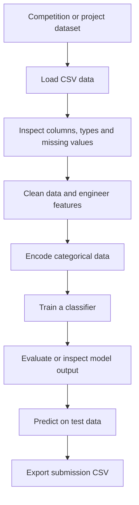
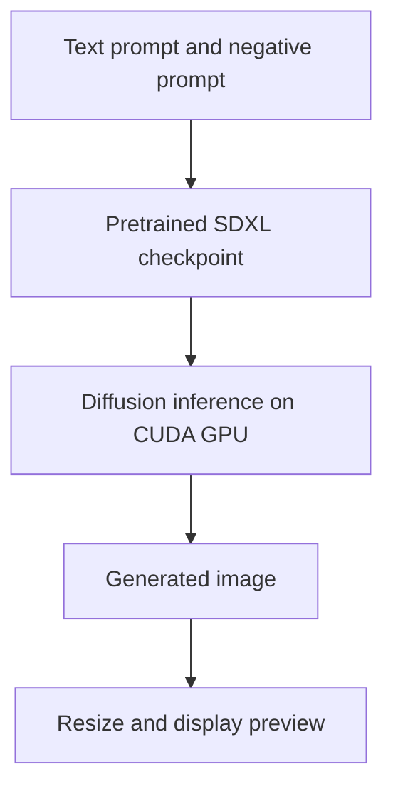

# Machine Learning & Generative AI Projects

A collection of hands-on Python notebooks exploring **tabular machine learning, feature engineering, classification, model evaluation, and text-to-image generation**. The repository brings together four predictive-modelling exercises and one diffusion-model image-generation experiment, primarily developed in Kaggle and Google Colab-style environments.

> **Project status:** Learning and experimentation repository. These notebooks are research/competition workflows, not packaged production applications or deployed prediction APIs.

## Table of contents

- [Repository at a glance](#repository-at-a-glance)
- [Project catalogue](#project-catalogue)
  - [Spaceship Titanic](#1-spaceship-titanic--passenger-transportation)
  - [Customer churn prediction](#2-customer-churn-prediction)
  - [Diabetes prediction](#3-diabetes-prediction)
  - [Irrigation-need prediction](#4-irrigation-need-prediction)
  - [Diffusion model image generation](#5-diffusion-model-image-generation)
- [How the notebooks work](#how-the-notebooks-work)
- [Technology stack](#technology-stack)
- [Getting started](#getting-started)
- [Datasets and input paths](#datasets-and-input-paths)
- [Reproducibility notes and known fixes](#reproducibility-notes-and-known-fixes)
- [Intended audience and use cases](#intended-audience-and-use-cases)
- [Limitations](#limitations)

---

## Repository at a glance

| Area | Included work | Main tools |
|---|---|---|
| Classification | Spaceship passenger transportation | Pandas, NumPy, XGBoost, scikit-learn |
| Classification | Customer churn | Pandas, scikit-learn, TensorFlow/Keras |
| Classification | Diabetes diagnosis label prediction | Pandas, scikit-learn, XGBoost |
| Classification | Irrigation-need categories | Pandas, scikit-learn, CatBoost |
| Generative AI | Prompt-based image generation | PyTorch, Hugging Face Diffusers, Stable Diffusion XL |

The repository is organised as a set of standalone notebooks. Each notebook contains its own data-loading and modelling workflow; there is no shared Python package, command-line interface, web application, or common training pipeline at present.

## Project catalogue

### 1. Spaceship Titanic — passenger transportation

**Notebook:** [`Spaceship_Titanic.ipynb`](Spaceship_Titanic.ipynb) · [Open in Google Colab](https://colab.research.google.com/github/DeepanshuSharma1607/project/blob/main/Spaceship_Titanic.ipynb) · [Kaggle competition](https://www.kaggle.com/competitions/spaceship-titanic)

**Goal:** Predict whether a passenger was transported to another dimension in the Spaceship Titanic competition dataset.

**Target:** `Transported` (binary classification).

**Workflow in the notebook:**

1. Load the competition training and test CSV files with Pandas.
2. Inspect data types, unique categorical values, missing values, and duplicate rows.
3. Split the `Cabin` field into `Deck`, `CabinNum`, and `Side`.
4. Engineer `TotalSpend` from the onboard spending columns and use spending information to infer missing `CryoSleep` values.
5. Impute missing numerical and categorical values; derive cabin zones from cabin numbers.
6. One-hot encode `HomePlanet`, `Destination`, `Deck`, and `Side`, and convert Boolean features to integers.
7. Train an `XGBClassifier` and evaluate it with five-fold stratified cross-validation.
8. Fit the model on the available labelled data, predict the competition test set, and write a submission CSV.

**Model configuration:** XGBoost with 500 estimators, learning rate `0.05`, maximum depth `6`, row and feature subsampling of `0.8`, and regularisation settings defined in the notebook.

**Recorded notebook result:** The saved five-fold cross-validation output reports **0.81054 ± 0.00908 accuracy**. This is a historical notebook output, not a guarantee that a fresh run will reproduce the same score; the result depends on the data and library versions.

**Output:** `__submission__.csv`.

### 2. Customer churn prediction

**Notebook:** [`customer_churn.ipynb`](customer_churn.ipynb) · [Kaggle Playground Series data](https://www.kaggle.com/competitions/playground-series-s6e3/data)

**Goal:** Classify whether a customer is likely to churn, using customer profile, service subscriptions, contract, and billing-related fields.

**Target:** `Churn` (`Yes` / `No`, mapped to `1` / `0`).

**Workflow in the notebook:**

1. Load the Kaggle Playground Series S6E3 training and test data.
2. Inspect dataset dimensions, feature types, missing values, and unique categorical values.
3. Separate the target and remove the competition `id` field from model inputs.
4. Explore numerical outliers using Seaborn box plots.
5. Build a `ColumnTransformer` that standardises numerical columns and one-hot encodes categorical columns, including previously unseen categories safely.
6. Train a fully connected TensorFlow/Keras neural network with two hidden layers, batch normalisation, dropout, and a sigmoid output.
7. Use binary cross-entropy and the Adam optimiser; apply early stopping based on validation loss and restore the best weights.
8. Generate predictions for the competition test set and create a submission file.

**Model configuration:** Dense layers of 128 and 64 units with ReLU activations, batch normalisation, dropout rates of `0.30` and `0.20`, and a one-unit sigmoid output layer. Training is configured for up to 500 epochs with early stopping (`patience=10`).

**Other approaches explored:** Logistic Regression and XGBoost submission code is present but commented out. The active model is the TensorFlow/Keras network.

**Output:** `submission_nn.csv`.

### 3. Diabetes prediction

**Notebook:** [`diabetes_pred.ipynb`](diabetes_pred.ipynb) · [Kaggle Playground Series data](https://www.kaggle.com/competitions/playground-series-s5e12/data)

**Goal:** Predict the dataset's `diagnosed_diabetes` label from demographic, lifestyle, medical-history, and health-measurement features.

**Target:** `diagnosed_diabetes` (binary classification).

**Workflow in the notebook:**

1. Load the Kaggle Playground Series S5E12 training and test CSV files.
2. Inspect columns, data types, duplicates, and categorical values.
3. One-hot encode demographic and lifestyle categories such as gender, ethnicity, education, income, smoking status, and employment status.
4. Remove the competition `id` from model features.
5. Create stratified training, validation, and holdout partitions (60%, 20%, and 20% of the labelled data).
6. Engineer additional features, including blood-pressure and cholesterol ratios, BMI/age interactions, activity and sleep indicators, lifestyle-risk scores, and family-history interactions.
7. Train an XGBoost classifier and compare prediction thresholds using confusion matrices and accuracy.
8. Inspect feature importances and experiment with a scaled Logistic Regression model as a comparison.
9. Generate test-set probabilities, apply a decision threshold, and write a competition submission.

**Main model:** XGBoost with 600 estimators, depth `7`, learning rate `0.03`, row and feature subsampling of `0.8`, and `gamma=1`.

**Additional experiment:** Logistic Regression is trained after scaling selected numerical features. It is a comparison model; the final submission code uses the XGBoost model.

**Output:** `submission.csv`.

> **Important:** This is a machine-learning exercise on a competition dataset. Its predictions are not clinical diagnoses, medical advice, or a validated healthcare screening tool.

### 4. Irrigation-need prediction

**Notebook:** [`prediction_irrigation.ipynb`](prediction_irrigation.ipynb) · [Kaggle Playground Series data](https://www.kaggle.com/competitions/playground-series-s6e4/data)

**Goal:** Predict the irrigation-need category from soil and environmental measurements, as framed by the competition dataset.

**Target:** `Irrigation_Need` (categorical classification label).

**Features inspected in the notebook:** Soil type, soil pH, soil moisture, organic carbon, electrical conductivity, temperature, humidity, and the remaining tabular competition features.

**Workflow in the notebook:**

1. Load the Kaggle Playground Series S6E4 training and test CSV files.
2. Inspect data types and descriptive statistics.
3. Separate `Irrigation_Need` from the features and remove the competition `id` field from model inputs.
4. Encode the target labels with `LabelEncoder`.
5. Identify categorical columns and pass them to CatBoost as categorical features.
6. Train a `CatBoostClassifier` and predict labels for the competition test set.
7. Convert predicted encoded labels back to their original categories and write a submission CSV.

**Model configuration:** CatBoost with 100 iterations, depth `6`, learning rate `0.1`, L2 leaf regularisation `3`, and random state `42`.

**Exploratory work:** The notebook contains commented-out experiments for train/validation splitting, one-hot encoding, scaling, Logistic Regression, and CatBoost hyperparameter search. These are not part of the active end-to-end training path.

**Output:** `submission1.csv`.

### 5. Diffusion model image generation

**Notebook:** [`diffusion_model.ipynb`](diffusion_model.ipynb) · [Open in Google Colab](https://colab.research.google.com/github/DeepanshuSharma1607/project/blob/main/diffusion_model.ipynb)

**Goal:** Generate a high-resolution image from a natural-language prompt using a pretrained text-to-image diffusion pipeline.

**Actual model used by the executable code:** [`Lykon/dreamshaper-xl-1-0`](https://huggingface.co/Lykon/dreamshaper-xl-1-0), loaded through `StableDiffusionXLPipeline` from Hugging Face Diffusers.

**Workflow in the notebook:**

1. Install or upgrade Diffusers, Transformers, and Accelerate.
2. Load the DreamShaper XL checkpoint using PyTorch in FP16 mode.
3. Move the pipeline to a CUDA GPU.
4. Supply a positive prompt and a negative prompt describing the desired image and unwanted visual attributes.
5. Generate an image using 45 inference steps and guidance scale `7.5`.
6. Display a 512 × 512 preview of the generated image.

The example prompt asks for a dramatic, studio-style commercial photograph of a metallic silver sports car. The saved notebook output contains a generated image preview.

**Model-reference clarification:** The notebook's Markdown also mentions the gated `FLUX.2-klein-base-9b-fp8` model and Hugging Face access instructions. However, the executable inference code loads **DreamShaper XL / Stable Diffusion XL**, not that FLUX model. Follow the executable code when reproducing the current notebook; the Markdown should be updated if the intended model changes.

**Requirements:** PyTorch, Diffusers, Transformers, Accelerate, and a compatible CUDA GPU for the current `.to("cuda")` workflow. Model downloads require an internet connection.

---

## How the notebooks work

The four tabular prediction notebooks share a general machine-learning pattern. The diffusion notebook is a separate generative workflow.





### Model-to-project map

| Notebook | Problem type | Active model | Main preprocessing / modelling techniques |
|---|---|---|---|
| `Spaceship_Titanic.ipynb` | Binary classification | XGBoost | Missing-value imputation, cabin parsing, feature engineering, one-hot encoding, stratified cross-validation |
| `customer_churn.ipynb` | Binary classification | TensorFlow/Keras neural network | ColumnTransformer, StandardScaler, OneHotEncoder, batch normalisation, dropout, early stopping |
| `diabetes_pred.ipynb` | Binary classification | XGBoost; Logistic Regression comparison | One-hot encoding, stratified splits, engineered health/lifestyle features, threshold analysis, feature importance |
| `prediction_irrigation.ipynb` | Categorical classification | CatBoost | Label encoding of target, native categorical-feature handling |
| `diffusion_model.ipynb` | Text-to-image generation | Stable Diffusion XL pipeline | Prompt conditioning, negative prompting, pretrained diffusion inference |

---

## Technology stack

| Technology | Use in this repository |
|---|---|
| **Python** | Notebook implementation language |
| **Jupyter Notebook** | Interactive, cell-based development and experimentation |
| **NumPy** | Numerical operations and array handling |
| **Pandas** | CSV loading, data inspection, cleaning, transformation, and submission creation |
| **Matplotlib** | Plotting and visual inspection |
| **Seaborn** | Statistical visualisation, including box plots in the churn notebook |
| **scikit-learn** | Preprocessing, encoders, scaling, train/test splitting, cross-validation, metrics, and Logistic Regression |
| **XGBoost** | Gradient-boosted classification for the Spaceship Titanic and diabetes notebooks |
| **TensorFlow / Keras** | Dense neural network for customer churn prediction |
| **CatBoost** | Gradient-boosted classification with categorical feature support for irrigation prediction |
| **PyTorch** | Tensor and model execution backend for image generation |
| **Hugging Face Diffusers** | Stable Diffusion XL inference pipeline |
| **Hugging Face Hub / Transformers / Accelerate** | Model and pipeline dependencies used by the diffusion workflow |
| **Kaggle** | Competition datasets and notebook-oriented data paths |
| **Google Colab** | Notebook launch links and cloud notebook execution for selected notebooks |

## Getting started

### 1. Clone the repository

```bash
git clone https://github.com/DeepanshuSharma1607/project.git
cd project
```

### 2. Choose a notebook

Open the relevant `.ipynb` file in Jupyter, VS Code, Kaggle, or Google Colab. The notebooks are independent; you do not need to run them in a particular order.

### 3. Install dependencies for the notebook you want to run

There is currently no repository-level `requirements.txt` or pinned environment file. Install the dependencies for the selected notebook rather than installing every framework unnecessarily.

**Spaceship Titanic**

```bash
pip install numpy pandas scikit-learn xgboost
```

**Customer churn**

```bash
pip install numpy pandas scikit-learn matplotlib seaborn tensorflow
```

**Diabetes prediction**

```bash
pip install numpy pandas scikit-learn xgboost
```

**Irrigation prediction**

```bash
pip install numpy pandas scikit-learn catboost
```

**Diffusion image generation**

```bash
pip install torch diffusers transformers accelerate safetensors
```

The diffusion notebook currently expects a CUDA-enabled GPU. The exact PyTorch installation command should match the CUDA/runtime configuration of the machine; use the official [PyTorch installation selector](https://pytorch.org/get-started/locally/) when setting up a local environment.

### 4. Provide the dataset files

The competition data is **not stored in this repository**. Download or attach the relevant CSV files from Kaggle and make sure they are available at the paths used in the selected notebook. See [Datasets and input paths](#datasets-and-input-paths).

### 5. Run and inspect the notebook

Run cells from top to bottom in a fresh kernel after applying the clean-run fixes listed below. Review the outputs and metrics before relying on predictions. For competition notebooks, the generated CSV should match the competition's sample-submission schema.

---

## Datasets and input paths

| Notebook | Dataset reference in code | Expected files / path |
|---|---|---|
| Spaceship Titanic | Spaceship Titanic competition | `/content/train.csv` and `/content/test.csv` |
| Customer churn | Playground Series S6E3 | `/kaggle/input/competitions/playground-series-s6e3/train.csv` and `test.csv` |
| Diabetes prediction | Playground Series S5E12 | `/kaggle/input/competitions/playground-series-s5e12/train.csv` and `test.csv` |
| Irrigation prediction | Playground Series S6E4 | `/kaggle/input/competitions/playground-series-s6e4/train.csv` and `test.csv` |
| Diffusion image generation | Hugging Face model repository | Model weights are downloaded by Diffusers; no local CSV dataset is used |

For local use, replace the notebook-specific Kaggle or Colab paths with the actual paths where you placed the downloaded files. Do not commit private datasets, Kaggle API tokens, or Hugging Face tokens to the repository.

## Reproducibility notes and known fixes

The notebooks preserve experimentation history, and a few cells need attention before a clean, restart-and-run-all execution. These points are included so that users do not mistake saved notebook outputs for proof that every notebook runs cleanly from an empty kernel.

### `Spaceship_Titanic.ipynb`

- The cell that evaluates `df.shape, y.shape` appears before `y` is assigned in the visible notebook source. Define `y` before that cell or remove the premature reference.
- The final submission cell references `df_test_raw["PassengerId"]`, but `df_test_raw` is not defined in the visible notebook cells. Save the IDs before dropping columns, for example:

  ```python
  df_test_raw = df_test[["PassengerId"]].copy()
  ```

- Confirm that the final training and test feature columns remain aligned after one-hot encoding. A single fitted encoder or explicit column alignment is more robust than independently encoding train and test data.

### `customer_churn.ipynb`

- The notebook reads duplicate copies of the training and test CSVs into `dummy_x` and `dummy_x_test`; those variables are not used by the active model workflow.
- The competition test labels are not available in the test CSV. The notebook therefore uses a validation split during neural-network training and writes predictions for the competition test rows.
- The active neural network is the TensorFlow/Keras model. Logistic Regression and XGBoost cells are commented-out experiments.

### `diabetes_pred.ipynb`

- The saved validation threshold loop leaves `pred_cv` set to the prediction from its final threshold (`0.70`). The subsequent printed validation accuracy therefore does not use the same default `0.50` threshold as `model_xgb.predict(x_test)`. Keep the threshold consistent when comparing validation and holdout performance.
- The final competition submission uses a probability threshold of `0.55`. Treat this as an experiment-specific choice, not a clinically meaningful decision threshold.
- Logistic Regression is a secondary experiment and emits a convergence warning in the saved output. Consider setting a suitable `max_iter`, checking scaling, and evaluating it independently if continuing that comparison.

### `prediction_irrigation.ipynb`

- The train/validation split cells are commented out, but a later cell calls `x_test.info()`. `x_test` is not created by the active code path, and the saved notebook records an error for that cell. Use `X_test.info()` there or remove the stale inspection cell.
- The active CatBoost fit uses the full labelled training dataset. The notebook does not currently run an active holdout or cross-validation evaluation, so it does not establish generalisation performance.
- A sample-submission CSV is loaded into `result` but is not used to build the final submission; the output DataFrame is created directly from the test IDs and decoded predictions.

### `diffusion_model.ipynb`

- The Markdown references a gated FLUX checkpoint, while the executable pipeline uses `Lykon/dreamshaper-xl-1-0` through `StableDiffusionXLPipeline`. Keep the explanation and code aligned if changing the model.
- The saved run reports that the prompt exceeds CLIP's 77-token input limit and is truncated. Shorten or rework the prompt when all details need to influence generation.
- The pipeline calls `.to("cuda")`; it will need a compatible GPU runtime. A CPU fallback would require changing the device and precision settings and may be substantially slower.

## Intended audience and use cases

This repository is intended for students, learners, and practitioners who want compact examples of applied machine learning and generative AI workflows.

| Audience / domain | What the notebooks demonstrate |
|---|---|
| Students learning applied ML | End-to-end tabular workflows: inspect, clean, encode, train, validate, and export predictions |
| Data science learners | Feature engineering, cross-validation, preprocessing pipelines, metrics, and model comparison |
| Telecom / subscription analytics learners | A customer churn classification workflow using customer and service attributes |
| Healthcare-data ML learners | A diabetes-label prediction exercise using health and lifestyle features; educational only, not clinical use |
| Agriculture / smart-farming learners | An irrigation-need classification workflow using soil and environmental measurements |
| Generative AI learners | Prompt-based image generation with a pretrained Stable Diffusion XL model |

The examples can serve as starting points for further work, such as packaging preprocessing and models into reusable pipelines, adding experiment tracking, conducting more rigorous evaluation, building a simple API or interface, and deploying a validated model. Those production components are not included in the current repository.

## Limitations

- The repository consists of notebooks rather than a tested Python package or deployable service.
- Dataset files are external and must be obtained separately.
- Dependencies are not pinned, so package upgrades may change behaviour or break compatibility.
- Notebook outputs are snapshots from previous executions and may not match a fresh run.
- Some modelling and validation experiments remain commented out or incomplete; see the clean-run notes above.
- The healthcare-related notebook is a competition-data exercise and must not be used to diagnose or treat people.
- No model should be considered production-ready without independent validation, appropriate monitoring, data-quality checks, security review, and domain-specific approval.

---

## Contributing / extending the work

A useful next step for any notebook is to make the workflow reproducible from a clean kernel: define all variables in execution order, centralise paths and configuration, pin dependencies, add a validation strategy, and document the exact dataset version. Larger extensions could move reusable preprocessing and inference code into Python modules and add tests for data schemas and prediction outputs.

## Author

Maintained by [DeepanshuSharma1607](https://github.com/DeepanshuSharma1607).

## Repository

[github.com/DeepanshuSharma1607/project](https://github.com/DeepanshuSharma1607/project)
